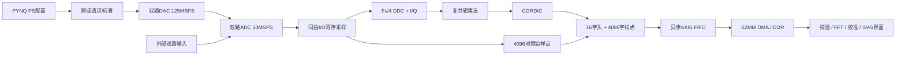

# 远场模拟无线电实时测向系统：设计报告

组别：AMD自主选题初级组。更新日期：2026-10-26。当前完整工程目录：far_field_radio_df_board。英文项目名：far_field_radio_df。器件：xc7z020clg400-2。板卡：正点原子领航者ZYNQ7020。目标镜像：`ZYNQ-7020-2.7.0.img`。队伍信息由参赛者在赛事系统按实际填写；本报告不虚构人员或学校。

## 1. 背景、问题与创新点

双路相位测量用于阵列信号处理、同步链路诊断和教学实验。直接把所有高采样率信号处理放在嵌入式Python端，会增加数据处理负担；只给一个PL结果又难以定位采样、运算和传输的错误。本系统把双路同步采集、相位计算、可调双路激励和PYNQ界面连接成可观测的实验链路，在虚拟双阵元远场模型中展示相位到方位的关系。

前期工程采用供应商双路DAC示例，以及已建立的单路ADC→AXIS FIFO→DMA→DDR教程链路。PYNQ官方示例提供Overlay与DMA访问能力，典型计数/loopback示例主要验证数字搬运。本作品在这些基础上扩展双路同拍样本、同帧PL结果/原始数据、可调激励、分模式校准及中间结果诊断；不声称发明了DDC、CORDIC或阵列测向原理，也不把示例板级输入来源归为原创。具体来源和待核实许可见 `third_party_notices.md`。

工程创新体现在：①同帧原始样点、I/Q、复乘与CORDIC四级可比对，定位首次分歧；②配置握手和周期边界原子应用，样本与gain/enable同步流水；③PYNQ双模式校准门控与保留FFT峰值的轻量显示；④从这些实际故障抽离可迁移的Overlay/DMA/黄金比对Skill。应用价值定位为可复现的教学与测试系统。当前只有有线模拟链路和虚拟场景，没有实装天线阵列或完成真实射频方向测量。

## 2. 原理与功能框图

设CH2-CH1相位为Δφ，采样率Fs=50MHz，信号频率f=12.5MHz=Fs/4。每路ADC连续收4096点。四相位本振累加：I+=x、Q-=x、I-=x、Q+=x；24bit I/Q累加器覆盖窗口中的有符号10bit输入。计算：

`Re=I2*I1+Q2*Q1`，`Im=Q2*I1-I2*Q1`，`Δφ=atan2(Im,Re)`。

48bit复乘结果输入24次迭代的CORDIC，角度编码为有符号32bit二进制角，`degree=int32*180/2**31`。接收计算不读取DAC设定相位。最后一个样点计入累加后才能锁存运算结果。

对于d=λ/4的等效阵列，远场平面波模型给出 `Δφ=90° sinθ`，故 `θ=arcsin(Δφ/90°)`。f=12.5MHz、取c≈3×10^8m/s时λ≈24m，d≈6m。6m是示意模型参数，不是板上物理间距。物理解限定|Δφ|≤90°；0.25°端点容差只稳定量化边界，明显超界显示模型越界，不输出虚假方向。

等效时间偏移为 `Δt=Δφ/(360f)`，反映有符号相位换算；单频相位具有周期模糊性，不能直接给出任意大时延。当前仅适用于相干12.5MHz单频测试；任意频率/宽带需重新设计本振、滤波和测相算法。

## 3. PS/PL划分依据

| 工作 | 实现侧 | 选择原因 / 代价 |
|---|---|---|
| ADC同拍采集、流协议、窗口缓存 | RTL PL | 明确每拍时序、双路配对、反压和帧边界 |
| DDC/累加、复乘、CORDIC | RTL PL | 窗口内固定本振运算在采样域累加；将中间结果一起回传供核对 |
| 原始数据与头部搬运 | AXIS FIFO、AXI DMA | 跨采样域至100MHz PS接口域，simple S2MM写DDR |
| FFT、黄金参考、零点标定、GUI | Python PS | 算法表达和交互便于修改；FFT与绘图消耗PS时间 |
| 双路激励配置 | Python→AXI GPIO→RTL | PS保持配置束，目的域周期边界应用并返回ack |

保留原始帧增加DDR带宽，但有利于功能证明和故障定位。一帧16448bytes，目标20FPS的平均净负载约328960bytes/s，计算值不包含DMA/AXI协议开销。4096点的采样窗口为81.92μs，是公式值，不是全帧端到端时延测量。PL与PS分别承担适合各自的任务，没有把轻量GUI刷新等同于无间断采集。

## 4. 接口设计

DMA实例 `axi_dma_0`：0x40400000，simple模式S2MM，32bit流，长度字段20bit。采集GPIO `axi_gpio_0`：0x41200000；bit0 start，bit1计数模式，bit2补码模式；状态busy/done/OTR。DAC GPIO `dac_gpio`：0x41210000；phase[9:0]、gain[18:10]、enable[19]、request[20]，返回ack toggle。

启动顺序：start置低、模式稳定、分配或复用私有PYNQ buffer、DMA receive transfer、start置高、有超时轮询、wait/cache invalidate、核对字节数，再复制为独立帧。实时模式复用已完成的缓冲，关闭仪表时释放；默认单次调用可保持一次性分配/释放。异常含KeyboardInterrupt时保留buffer，成功硬件复位后才释放。FIFO done仅表示流端完成，DDR完成以DMA为准。

包长4112个uint32。头部word0 magic `0x50484D31`，word1帧序号，word2样点对数，word3完成/OTR/零向量/自检/编码标志，word4角度，word5..8 I1/Q1/I2/Q2，word9..12 Re/Im，word13采样率，word14本振，word15协议版本。word16..4111低10bit为ADC1，bit10 OTR1，bit25..16 ADC2，bit26 OTR2。

自检负载为0..4095，不能算模拟采集正确性。真实样点按offset binary或two's complement解码；低于3codes基波幅度、零向量、OTR、自检帧不输出有效相位。

DAC相位分辨率360/1024≈0.3515625°，增益0..1按1/256量化。125MSPS输出12.5MHz正弦每周期10个数字点。2026-10-25改用5120精确数学相位网格、16bit Q6系数和最终对称舍入，物理ROM补零至8192深度并加入地址/控制流水。未滤波仍会有阶梯和镜像，需区分模拟重建效果与数字配置混样。

## 5. 优化过程与前后对比

以下性能表区分用户观察、配置目标、仿真和实测；历史源码快照、相同仪器基线CSV及完整旧资源报告没有全部保留，缺失项保持未测。

| 对象 | 优化前观察 / 基线 | 最终行为与验证 | 定量边界 |
|---|---|---|---|
| PL/软件一致性 | 9月26日用户报告软件稳定而PL跳动 | 唯一I/O寄存采样对同时送BRAM/DDC；四级同帧核对；RTL/协议测试通过 | 未提供优化前后同条件板上CSV，不能给出抖动改善倍数 |
| DAC更新 | 9月26日用户报告相位/幅度变更后CH2波形异常 | 周期边界握手、gain/enable样本标签、饱和与OLOGIC输出；默认gain0.5全部1024相位码及配置切换仿真 | 原异常包含数字/模拟多种可能；需要示波器和回采实测闭环 |
| GUI刷新 | 9月27日用户反馈约5s/次 | 整数四相核对、DMA复用、缓存与分频显示；数值目标20Hz、频谱5Hz、历史/模型10Hz、状态2Hz | 目标频率不当作实测；2026-10-25用户报告旧版5.9FPS/约60ms，新增完整分段计时，板上收益待测 |
| 频谱尖峰 | 9月27日图上12.5MHz峰不可见 | 图形频率区间保留max；单bin峰测试通过 | 需板上截图与FFT原始数值证明显示质量 |
| 方位端点 | 9月27日90°相位显示约80° | 模型定义域和0.25°量化容差；±90°/超界离线测试通过 | 有效方向仍依赖校准和模型 |
| 从零构建 | 本次reset_run引用不存在的IP run | generate_target后create_ip_run，构建成功 | 真实失败日志保留；另修复迁移后的reference路径 |
| 交付一致性 | 原审计运行时直接刷新manifest，可能掩盖替换 | 审计默认只读，显式生成时刷新；篡改检测测试通过 | 元数据匹配不是电气适配证明 |

以下是本地保留的历史资源一致性表，见 `optimization_comparison.csv`；本轮优化后资源需另按当前重建报告比较：

| 指标 | 历史2026-09-26最终报告 | 2026-10-11同RTL复现 |
|---|---:|---:|
| LUT | 3151 / 53200 | 3151 / 53200 |
| FF | 3515 / 106400 | 3515 / 106400 |
| BRAM Tile | 6.5 / 140 | 6.5 / 140 |
| DSP | 10 / 220 | 10 / 220 |
| WNS / TNS | 1.113ns / 0 | 1.113ns / 0 |
| WHS / THS | 0.034ns / 0 | 0.034ns / 0 |

这是2026-10-11整理时相同RTL的一致性对比，属于历史基线。原验证正文曾写LUT3123/FF3524，与原始utilization.rpt不一致；本报告以保留的工具原始报告为准。

2026-10-25正式主目录经DAC1参考表修复后，实际资源为LUT3164、FF3557、BRAM10、DSP12；WNS0.230ns/TNS0、WHS0.045ns/THS0。相对历史基线增加13 LUT、42 FF、3.5 BRAM、2 DSP，代价来自精确相位ROM与流水。完整前后表在optimization_comparison.csv，当前原始报告和metrics.json可核查；没有把增加精度的资源开销宣传为节省。先前共享ROM版本虽通过RTL仿真，却在实现后使DAC1地址固定为0；现已加入路由后功能门控，故障定位与修复依据已合并到verification.md。

当前可运行基线：`board/collect_measurements.py`中的CPU DFT黄金算法对同一帧进行测相；候选为PL CORDIC结果。保存相位误差和主机计时；capture_s已包含驱动解码的四相软件参考，pl_word_decode_s只是主机字段换算，不能两者直接相除当系统加速比。完整板上优化比较仍需添加同输入、同窗口、同软硬件版本下的纯计算/端到端/稳定性指标及真实基线资源报告。

2026-10-25的优化根据上述旧版面板数据，重点降低PS/界面工作量和可计算的DAC生成误差。5.9FPS约169ms，旧60ms计时未覆盖约109ms的绘图/通信/调度；新版本计时覆盖完整处理。32帧零校准和可关闭圆周平滑保留原始相位/误差，不将-45°约-0.6°拟合成补偿常数。

数字DAC模型在gain0.5下，±45°残差由约±0.092916°降至±0.004372°，全1024相位码最大0.145005°降至0.117202°。低增益0.125/0.25的部分相位会变差；数字模型不包括模拟链路，不能据此宣称新版上板±0.004°。分频策略与数字精度边界见本节，验证与数据采集入口见[验证报告](verification.md)及board/README.md。

## 6. 验证与结果

10月25日在当时正式主目录完成 Vivado2020.2 重建、BIT/HWH 核对、HWH 契约、CDC/DRC 及 20 个 DAC 输出 OLOGIC 检查。DAC1 修复后又完成路由后功能门控和 58 项离线测试；中间版本的 REPRODUCTION_PASS/46 项通过属于较早阶段，不能替代修复后的证据。本轮 10月26日迁入当前完整目录并更新软件界面与材料，硬件版本不变；不重复宣称完成新的硬件重建。ADC/DAC外部I/O延迟未完成预算，内部通过不能替代板级时序签核。

RTL采集/测相11帧，含全部象限、±179°、180°、编码、零信号、OTR、自检、反压、start保持及阻塞复位；DAC默认gain0.5遍历全部1024相位码并检查配置切换；CORDIC两种幅度逐角遍历。原始仿真输出在build/reports/current/simulate.log，历史参考CSV在data/reference。离线 Python 测试覆盖驱动、GUI、profile 工具、对话导出和通用 Skill，本次64项通过的日志为 `build/reports/current/python_tests_delivery_20261026.log`。最新完整验证摘要由 `verification.md` 给出。

历史用户明确反馈“目前项目已经能够测量两路信号相位差”，属于定性上板观察。2026-10-25补充旧版面板数据：gain0.5、5.9FPS、采集/计算约60ms，0°为-0.10..0.01°，-45°为-45.64..-45.55°，+45°为44.96..45.01°；这些范围没有原始帧，不计算为真实统计均值或新版精度。用户现已确认两路 DAC 正常，并纠正此前同轴线松动，连接修复后观察到约 ±1°误差；这是未附原始帧的当前反馈，不是全范围测向角精度。原“最大约5°”不再用于认定算法非线性，也没有据此引入补偿。当前整理环境没有连接开发板，也没有收到带本次 manifest 的实测 CSV/NPZ；本报告不把合成黄金数据或历史反馈当作新版本上板实测。正式提交前执行board脚本并补仪器比较、编码/量程依据、持续运行和实际FPS证据。

## 2026-10-26 展示设计修订

视频演示和日常操作以“输入相位变化如何影响等效方向”为核心，因此将相位、测向角放大，把远场模拟场景作为主视觉，频谱缩为辅助。移除正常页面的 FPS、分段耗时、CORDIC−软件差和原始幅度提示，将这些证据留给独立维护/采集工具。正常页面仍须给出信号、校准与模型越界状态，避免简化视觉后掩盖无效测量。

主视图的大号读数只表示测量结果，场景是 d=λ/4 的模型推导，不意味着已部署天线阵列。约 ±1°的相位误差观察也不能直接写成 ±1°的测向角精度，尤其模型端点附近方向对相位误差更敏感。实际板级原始证据仍待采集补齐。

本轮保留原始数据门控、零点校准与有效性判断，没有根据设定相位改变测量结果，没有用显示平滑证明精度改善。采用目录提交并保留运行副本与完整工程的对照。

## 7. 大模型协作与Skill提炼

公开交互原文在 `interaction/transcript.md` / `messages.jsonl`，来源哈希及模型标识在 `sources.json`。按用户选择，仅保留“目前项目已经能够测量两路信号相位差”这一对话的 19 条公开消息；其他对话已从提交材料移除。内容涵盖双模式 GUI、独立校准、方向越界、频谱窄峰和端点显示修正。模型记录以该对话元数据为准；没有部署本地开源权重、微调或专用训练，也没有把3.1赛道要求套进3.3。

所选对话体现需求→项目设定核实→实现→离线检查→用户反馈→修正的过程。用户指出方向固定、频谱峰值消失和端点角度偏差后，模型分别调整越界处理、频谱保峰及相位/方向解释。`collaboration.md` 仅索引该对话；其他构建、仿真和工程演进事实由各自技术报告及工具日志说明，不宣称其完整对话原文仍包含在提交中。

提炼过程从“哪里第一次不一致”与“为什么旧目录能build而空目录不能”出发，抽离接口契约、版本哈希、DMA缓存与所有权、CDC配置原子性、黄金比对和未知报告拒绝策略。通用脚本不带测相协议/ADC常量，离线在两套不同IP名、不同长度/类型负载上验证。适用范围、使用方法、效果、来源和失效条件逐项写入 `skill/README.md`。没有做多板卡实测或跨模型稳定性统计，模板不声称普适成功率。

## 8. 完整复现与提交缺项

按根README从零构建和离线测试，再按board说明复制、校验、运行及采集；保留工具版本、原始输出、manifest和运行环境。新路径不依赖旧工程。许可选择MIT，第三方例程/衍生来源单独核实。最后补实测、优化基线、来源授权、公开网址与参赛信息，执行 `prepare_submission.py` 目录核验并刷新提交清单，不生成压缩包。

指南其他条款：初级组按队员最高学历/年级判断；混合高年级按高级组处理，参赛者需自行核实。所有入围自主选题队伍还需使用AMD提供的PPT模板制作一页英文海报，去掉队伍信息后A4彩色打印带到决赛；目前未提供官方模板，入围后按实际官方模板补充。时间节点和具体评分以官方公告为准，本报告不推测截止日。

## 9. 参考依据

- 本地2026 AMD选题指南3.3，PDF实际页22-25，印刷页19-22；另“六、其它”实际页28/印刷页25。
- [PYNQ 2.7 DMA](https://pynq.readthedocs.io/en/v2.7.0/pynq_libraries/dma.html)、[DMA源码](https://pynq.readthedocs.io/en/v2.7.0/_modules/pynq/lib/dma.html)、[allocate](https://pynq.readthedocs.io/en/v2.7.0/pynq_libraries/allocate.html)。
- AMD/Xilinx Vivado UG901、UG904、UG949，实际工具报告和XDC；不复制未授权文档正文。
